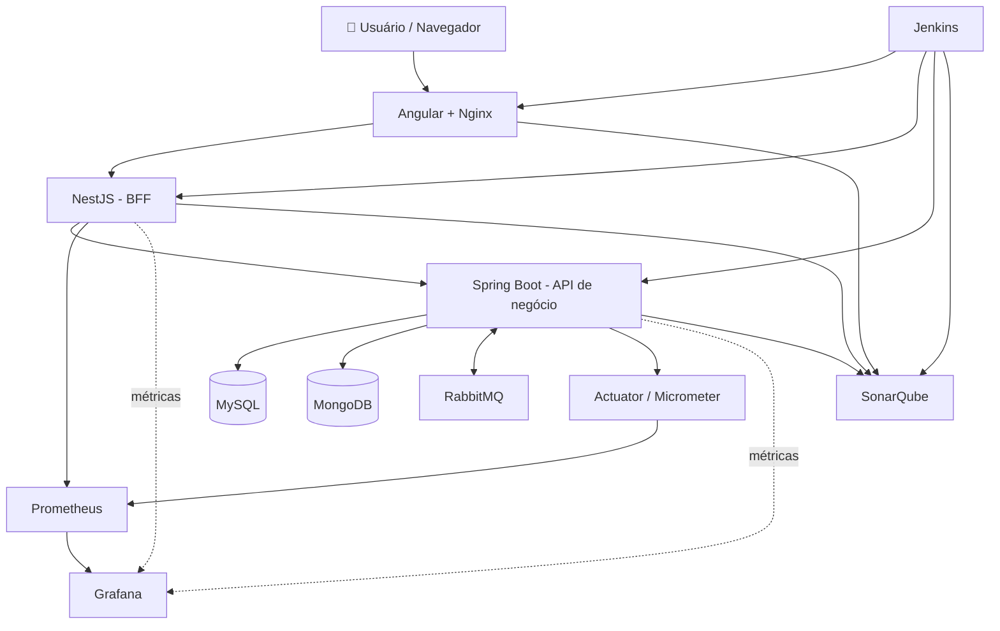

<div align="center">

# 🧩 Sistema Gerencial Full Stack

### Gestão empresarial, atendimento técnico, operações comerciais e controle financeiro em uma arquitetura modular


[](https://www.mysql.com/)
[](https://www.mongodb.com/)
[](https://www.rabbitmq.com/)
[](https://www.jenkins.io/)

**Um projeto funcional, construído como laboratório prático para estudar front-end, BFF, APIs de negócio, persistência, mensageria, testes, observabilidade e CI/CD em uma solução integrada.**

[Funcionalidades](#-funcionalidades) · [Arquitetura](#-arquitetura) · [Execução](#-execução-local-com-docker) · [Qualidade](#-testes-e-qualidade) · [Documentação](#-documentação-adicional)

</div>

---

## ✨ Sobre o projeto

O **Sistema Gerencial Full Stack** é uma aplicação para organizar diferentes operações de uma empresa: relacionamento com clientes, cadastro de equipamentos, atendimento e manutenção, agenda, orçamentos, vendas, caixa e financeiro.

A solução foi construída com **Angular** na experiência web, **NestJS como Backend for Frontend (BFF)** e **Spring Boot** como camada central de regras de negócio. A persistência utiliza **MySQL** e **MongoDB**, com **RabbitMQ** para mensageria. A interface incorpora uma identidade visual inspirada no estilo **Frutiger Aero**.

Mais do que um protótipo isolado, este é um **projeto funcional**, com módulos reais, fluxos implementados, testes automatizados e infraestrutura de apoio. Ao mesmo tempo, ele foi concebido como um **ambiente de estudo prático**, com o objetivo de explorar de ponta a ponta as tecnologias envolvidas na construção de uma aplicação Full Stack moderna.

> 📌 **Escopo:** projeto funcional usado como laboratório de estudos e evolução contínua. A proposta é aprender e validar, em um único sistema, temas como arquitetura em camadas, BFF, APIs REST, autenticação, bancos de dados, mensageria, testes, observabilidade e CI/CD. A presença de um componente na infraestrutura não significa que exista implantação pública em produção.

## 🚀 Funcionalidades

| Área | Recursos documentados/identificados |
| --- | --- |
| 🏢 **Cadastros** | Empresas, clientes e equipamentos |
| 🛠️ **Atendimentos** | Registro, acompanhamento e alteração de status |
| 🔧 **Manutenções** | Operações e histórico de manutenção |
| 📅 **Agenda** | Agendamentos e eventos de calendário |
| 🧾 **Comercial** | Orçamentos, produtos, serviços e vendas |
| 💳 **Financeiro** | Contas a pagar e a receber, baixas parciais/totais e relatórios |
| 💰 **Caixa** | Registro e acompanhamento de recebimentos comerciais |
| 📊 **Dashboards** | Indicadores e consultas consolidadas para acompanhamento operacional |
| 🔐 **Acesso** | Autenticação JWT, cookies HttpOnly e autorização por perfis |
| 📨 **Integração** | Mensageria e fluxo de eventos entre componentes |

### 💳 Destaque: módulo financeiro

- Lançamentos manuais de **contas a pagar** e **contas a receber**.
- Integração com parcelas de vendas, sem duplicação dos títulos na base financeira.
- Pagamentos e recebimentos **parciais ou totais**, com validação transacional.
- Relatórios por período e categoria, incluindo **exportação CSV**.
- Regras de cancelamento e preservação de histórico.
- Acesso restrito aos perfis **ADMIN** e **DEV**.

Detalhes de implantação, migração e endpoints: [`FINANCEIRO.md`](FINANCEIRO.md).

## 🏗️ Arquitetura



### Responsabilidades por camada

- **Angular:** telas, formulários, navegação, componentes visuais e consumo do BFF.
- **NestJS:** ponto de entrada do front-end, repasse de parâmetros e cabeçalhos, integração com cookies de autenticação e proxy para o serviço Java.
- **Spring Boot:** regras de negócio, segurança, validação, transações e integrações de dados.
- **MySQL:** dados relacionais de operações gerenciais e comerciais.
- **MongoDB:** armazenamento associado à auditoria e documentos.
- **RabbitMQ:** infraestrutura de eventos e processamento assíncrono.
- **Prometheus + Grafana:** coleta e visualização de métricas, especialmente para back-end e BFF.
- **Jenkins + SonarQube:** pipeline, execução de build/testes e análise de qualidade de front-end, BFF e back-end.

## 🧰 Stack tecnológica

| Camada | Tecnologias |
| --- | --- |
| Front-end | Angular, TypeScript, Nginx |
| BFF | NestJS, Node.js, TypeScript |
| API | Java 27, Spring Boot 3.5, Spring Security, Spring JDBC/JPA |
| Dados | MySQL, MongoDB |
| Integração | RabbitMQ, REST, JWT |
| Qualidade | JUnit, JaCoCo, Jest, Karma, SonarQube |
| Observabilidade | Spring Actuator, Micrometer, Prometheus, Grafana |
| Infraestrutura | Docker, Docker Compose, Jenkins |

## 📂 Organização do repositório

```text
sistema-gerencial-fullstack/
├── back-end/          # API Java / Spring Boot
├── bff/               # Backend for Frontend NestJS
├── front-end/         # Aplicação Angular
├── db/                # Inicialização e migrações MySQL
├── ndb/               # Configuração MongoDB
├── mensageria/        # RabbitMQ
├── prometheus/        # Métricas
├── grafana/           # Dashboards e provisionamento
├── infraestrutura/    # Agente Jenkins e suporte
├── Jenkinsfile        # Pipeline CI/CD
├── docker-compose.yaml
├── FINANCEIRO.md
└── TESTING.md
```

## 🐳 Execução local com Docker

### Pré-requisitos

- Docker Engine ou Docker Desktop com Compose.
- Portas locais disponíveis para os serviços habilitados.
- Recursos suficientes para os containers de aplicação, bancos e ferramentas de observabilidade.

```bash
git clone https://github.com/KalleoLeandro/sistema-gerencial-fullstack.git
cd sistema-gerencial-fullstack
docker compose up -d --build
```

Após a inicialização, os endpoints configurados no Compose são:

| Serviço | Endereço local |
| --- | --- |
| Interface Angular | http://localhost:4200 |
| BFF NestJS | http://localhost:3000 |
| Swagger BFF | http://localhost:3000/api |
| API Spring Boot | http://localhost:8080/api |
| Swagger backend | http://localhost:8080/api/swagger-ui.html |
| RabbitMQ Management | http://localhost:15672 |
| Prometheus | http://localhost:9090 |
| Grafana | http://localhost:3001 |
| SonarQube | http://localhost:9000 |

> ⚠️ **Segurança:** o Compose presente no repositório utiliza credenciais demonstrativas de desenvolvimento, inclusive `root/root`, `guest/guest` e senha padrão do Grafana. **Não exponha esses serviços à internet sem trocar as credenciais, restringir as portas e revisar as configurações de produção.**

A infraestrutura Jenkins está definida no perfil opcional `ci`:

```bash
docker compose --profile ci up -d --build
```

Antes de habilitar o agente, configure `JENKINS_AGENT_SECRET` e o controlador Jenkins conforme sua instalação. Para acompanhar e encerrar:

```bash
docker compose logs -f
docker compose down
```

`docker compose down` não apaga os volumes persistentes por padrão. Evite `down -v` se quiser preservar os dados.

## 🔐 Segurança e autenticação

O projeto utiliza **Spring Security**, autenticação baseada em **JWT**, fluxo de **access/refresh tokens** e uso de **cookies HttpOnly**. O BFF concentra a passagem de credenciais entre o navegador e a API Java; o backend permanece responsável por validar a autenticação e as permissões.

A cobertura automatizada inclui cenários de expiração, assinatura inválida, renovação, logout e respostas **401/403**. Para uma implantação real, também devem ser revisadas políticas de cookies, CORS, TLS, gerenciamento de segredos e acesso aos serviços internos.

## ✅ Testes e qualidade

As métricas abaixo são **resultados registrados na documentação do repositório**, e não medições realizadas durante a elaboração deste README.

| Componente | Testes registrados | Cobertura de linhas | Cobertura de branches |
| --- | ---: | ---: | ---: |
| API Spring Boot (13/10/2026) | 397 | 96,08% | 86,84% |
| BFF NestJS (14/10/2026) | 144 | 99,78% | 96,72% |
| Front-end Angular (14/10/2026) | 521 | 97,08% | 92,43% |

A verificação JaCoCo exige **mínimo de 90% de linhas e 80% de branches** no backend. Para BFF e front-end, a documentação define **mínimo de 90%** nas métricas de cobertura utilizadas por suas suítes.

```bash
# API: executar na pasta back-end com JDK 27
mvn clean verify

# BFF: executar na pasta bff
npm ci
npm run test:ci

# Front-end: executar na pasta front-end (Chrome/Chromium requerido)
npm ci
npm run test:ci
```

Os testes automatizados utilizam mecanismos de isolamento e mocks; a suíte, isoladamente, não substitui testes integrados com todos os serviços reais.

## 🔄 CI/CD e observabilidade

O repositório contém um [`Jenkinsfile`](Jenkinsfile) e configuração de agente em `infraestrutura/jenkins-agent`, além de integração com **SonarQube** e coleta de métricas por **Prometheus** para visualização no **Grafana**.

Esse conjunto demonstra práticas de **build automatizado, verificação de testes e cobertura, análise estática e acompanhamento operacional**. No contexto do projeto, o **Jenkins** representa a orquestração das etapas de integração contínua dos três blocos principais (**front-end, BFF e back-end**), enquanto o **SonarQube** centraliza a análise de qualidade desses componentes. Na observabilidade, **back-end** e **BFF** expõem métricas que podem ser acompanhadas via **Prometheus** e visualizadas no **Grafana**. A execução da pipeline depende da configuração local do Jenkins, credenciais e serviços externos definidos para o ambiente.

## 🖼️ Interface

O front-end explora uma identidade visual **Frutiger Aero**, com foco em uma experiência visual distinta para um sistema de gestão.

> 💡 **Galeria sugerida:** adicione capturas reais em `docs/screenshots/` (login, dashboard, atendimentos, agenda, vendas e financeiro) e substitua esta observação por imagens. Nenhuma captura foi presumida ou criada sem acesso à aplicação em execução.

## 📚 Documentação adicional

- [`FINANCEIRO.md`](FINANCEIRO.md) — módulo financeiro, regras e APIs.
- [`TESTING.md`](TESTING.md) — testes e cobertura do BFF e front-end.
- [`back-end/TESTING.md`](back-end/TESTING.md) — cobertura JaCoCo, testes Java e isolamento.
- [`Jenkinsfile`](Jenkinsfile) — definição da pipeline.

## 👨‍💻 Autor

Desenvolvido por **[Kalleo Leandro](https://github.com/KalleoLeandro)** como um projeto funcional voltado ao estudo e à evolução prática de soluções Full Stack, arquitetura de software, testes automatizados, observabilidade e DevOps.

<div align="center">

---


[⬆ Voltar ao topo](#-sistema-gerencial-full-stack)

</div>
